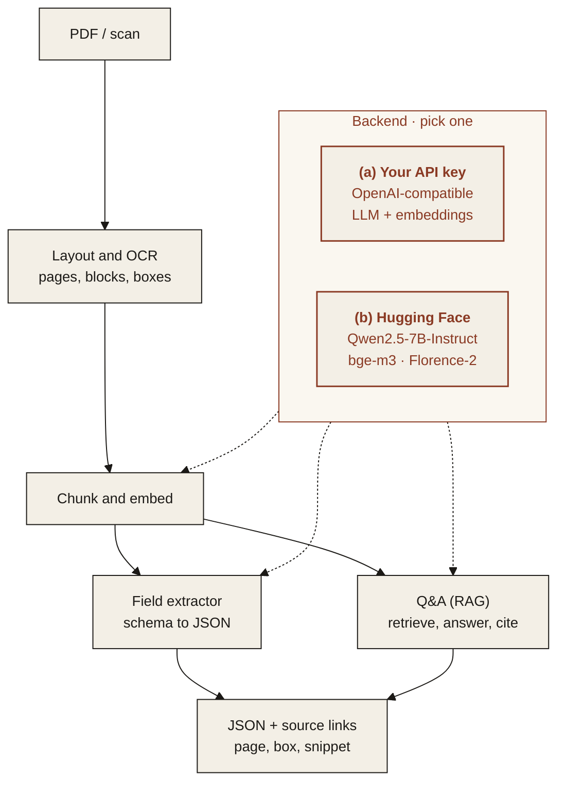

<p align="center">
  
</p>

<p align="center"><em>Turn PDF invoices and contracts into structured fields, each linked to its source.</em></p>

<p align="center">
  
  
  
  
</p>

---

## Features

Planned for v1. Progress is tracked in the Roadmap below.

- **Field extraction to JSON**: define the fields you want (invoice number, totals, parties, dates) and get typed JSON back.
- **Source citation per value**: every value carries the page and bounding box it came from, so it can be checked in one click.
- **Q&A over the document (RAG)**: ask a question and get an answer grounded in cited passages.
- **Batch mode**: point it at a folder and get one JSON file and one CSV summary per run.
- **Web demo**: drop a PDF, see fields highlighted on the page.

## Architecture



### Two interchangeable backends

Pick one with `MS_BACKEND` in `.env`. The rest of the pipeline does not change.

| | (a) Bring your own API key | (b) Open-source on Hugging Face |
|---|---|---|
| **What** | Any OpenAI-compatible endpoint | Open models, run locally or via Hugging Face Inference |
| **Set** | `MS_BACKEND=api`, `OPENAI_BASE_URL`, `OPENAI_API_KEY` | `MS_BACKEND=hf`, `HF_MODE=local` or `inference` |
| **Good for** | Fastest start, strongest hosted models | Data stays on your machines, no per-call cost |

**Default open-source models**

| Model | Used for | License |
|---|---|---|
| [`Qwen/Qwen2.5-7B-Instruct`](https://huggingface.co/Qwen/Qwen2.5-7B-Instruct) | field extraction and answers | Apache-2.0 |
| [`BAAI/bge-m3`](https://huggingface.co/BAAI/bge-m3) | embeddings for retrieval | MIT |
| [`BAAI/bge-reranker-v2-m3`](https://huggingface.co/BAAI/bge-reranker-v2-m3) | reranking retrieved passages | Apache-2.0 |
| [`microsoft/Florence-2-large`](https://huggingface.co/microsoft/Florence-2-large) | OCR for scanned pages | MIT |

## Quickstart

> **Coming soon.** The commands below show the planned interface.

```bash
git clone https://github.com/ModelShifts/document-extractor
cd document-extractor
cp .env.example .env   # choose a backend
pip install -e .
document-extractor extract invoice.pdf --schema schemas/invoice.yaml
document-extractor ask contract.pdf "When does the notice period start?"
```

## Roadmap

- [x] Repository scaffold and README
- [ ] PDF parsing with page and box coordinates
- [ ] Schema-driven field extraction
- [ ] Source citation per value
- [ ] Q&A over the document (RAG)
- [ ] Batch mode
- [ ] Web demo

## License

[MIT](LICENSE) © Modelshifts Technology Pte. Ltd.

<p align="center"><sub>Part of the <a href="https://modelshifts.com/work">Modelshifts</a> showcase.</sub></p>
