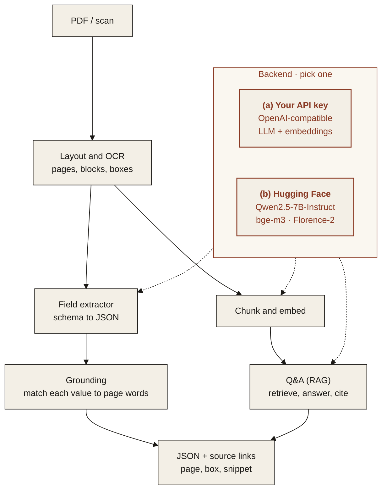

<p align="center">
  
</p>

<p align="center"><em>Turn PDF invoices and contracts into structured fields, each linked to its source.</em></p>

<p align="center">
  
  
  
  
</p>

---

## Features

All five features below work in v1. See [Limitations](#limitations) for what they do not cover yet.

- **Field extraction to JSON**: define the fields you want (invoice number, totals, parties, dates) and get typed JSON back.
- **Source citation per value**: every value carries the page and bounding box it came from, so it can be checked in one click.
- **Q&A over the document (RAG)**: ask a question and get an answer grounded in cited passages.
- **Batch mode**: point it at a folder and get one CSV or JSON file per run.
- **Web demo**: pick a sample or upload a PDF, see fields highlighted on the page.

<p align="center">
  
</p>
<p align="center"><sub>Web demo on a synthetic invoice (<a href="assets/demo.mp4">MP4</a>). Results in the recording were computed earlier by Qwen2.5-1.5B-Instruct on CPU and loaded from the demo's result cache.</sub></p>

## Architecture



### Two interchangeable backends

Pick one with `MS_BACKEND` in `.env`. The rest of the pipeline does not change.

| | (a) Bring your own API key | (b) Open-source on Hugging Face |
|---|---|---|
| **What** | Any OpenAI-compatible endpoint | Open models, run locally with `transformers` |
| **Set** | `MS_BACKEND=api`, `MS_API_BASE`, `MS_API_KEY`, `MS_MODEL` | `MS_BACKEND=hf`, optionally `MS_HF_MODEL` |
| **Scanned pages** | `MS_VISION_MODEL` (a vision model on the same endpoint) | Florence-2 |
| **Q&A retrieval** | `MS_EMBED_MODEL` if set, otherwise BM25 | bge-m3 |
| **Good for** | Fastest start, strongest hosted models | Data stays on your machines, no per-call cost |

**Default open-source models**

| Model | Used for | License |
|---|---|---|
| [`Qwen/Qwen2.5-7B-Instruct`](https://huggingface.co/Qwen/Qwen2.5-7B-Instruct) | field extraction and answers | Apache-2.0 |
| [`BAAI/bge-m3`](https://huggingface.co/BAAI/bge-m3) | embeddings for retrieval | MIT |
| [`florence-community/Florence-2-large`](https://huggingface.co/florence-community/Florence-2-large) | OCR for scanned pages (`transformers`-native copy of [`microsoft/Florence-2-large`](https://huggingface.co/microsoft/Florence-2-large)) | MIT |

On a machine without a GPU, set `MS_HF_MODEL=Qwen/Qwen2.5-1.5B-Instruct`. The 7B model needs a GPU or a lot of memory.
`MS_RETRIEVER=bm25` skips the bge-m3 download and uses keyword retrieval instead.

## Quickstart

Python 3.11 or newer.

```bash
git clone https://github.com/ModelShifts/document-extractor
cd document-extractor
python -m venv .venv && source .venv/bin/activate
pip install -e ".[hf,demo]"      # open models; use ".[api,demo]" for the API backend
cp .env.example .env              # choose a backend and models
```

On a CPU-only machine, install the CPU build of PyTorch first (`pip install torch --index-url https://download.pytorch.org/whl/cpu`) and set `MS_HF_MODEL=Qwen/Qwen2.5-1.5B-Instruct` in `.env`. Models download from Hugging Face on first use.

```bash
# fields as JSON, each with {page, bbox, text}
document-extractor extract samples/invoice-northwind-classic.pdf --schema schemas/invoice.yaml

# a question, answered with cited passages
document-extractor ask samples/contract-master-services.pdf "When does the notice period start?"

# a folder to one CSV (or .json)
document-extractor batch samples --glob "invoice-*.pdf" --schema invoice --out results.csv

# the web demo at http://127.0.0.1:7860 (python app.py does the same)
document-extractor serve
```

### Using the API backend

Any OpenAI-compatible endpoint works. In `.env`:

```bash
MS_BACKEND=api
MS_API_BASE=https://your-provider.example/v1
MS_API_KEY=your-api-key
MS_MODEL=your-chat-model
```

To try it without a paid key, run an open model behind a local OpenAI-compatible server, for example [llama-cpp-python](https://github.com/abetlen/llama-cpp-python):

```bash
pip install "llama-cpp-python[server]" huggingface_hub \
  --extra-index-url https://abetlen.github.io/llama-cpp-python/whl/cpu   # prebuilt CPU wheels, no compiler needed
hf download Qwen/Qwen2.5-1.5B-Instruct-GGUF qwen2.5-1.5b-instruct-q4_k_m.gguf --local-dir models
python -m llama_cpp.server --model models/qwen2.5-1.5b-instruct-q4_k_m.gguf --n_ctx 8192 --port 8001
# then: MS_API_BASE=http://127.0.0.1:8001/v1  MS_API_KEY=local  MS_MODEL=qwen2.5-1.5b-instruct-q4_k_m
```

### Schemas

A schema is a YAML file that lists fields and their types (`string`, `date`, `number`, `integer`). See [`schemas/invoice.yaml`](schemas/invoice.yaml) and [`schemas/contract.yaml`](schemas/contract.yaml). Dates come back as `YYYY-MM-DD` and amounts as numbers. The model is asked to copy each value as printed, and the value is then matched back to the words on the page to find its box.

### Sample documents and tests

`samples/` holds seven synthetic PDFs (four invoice layouts, two contracts, one image-only scan) with a ground-truth file for each. All names and figures in them are fictional.

```bash
pip install -e ".[dev]"
python scripts/make_samples.py   # regenerate samples/
pytest                           # uses a mocked model, no downloads
python scripts/evaluate.py       # compare the configured backend with the ground truth
```

## Limitations

- The samples are synthetic and have simple layouts. The project has not been measured on real-world documents.
- On a CPU, extraction with the open models takes tens of seconds per document, and loading Qwen, bge-m3 and Florence-2 together needs several GB of memory. The 7B default needs a GPU.
- Florence-2 reads a scanned page in one pass, so small or dense text can be misread. On the API backend, OCR through `MS_VISION_MODEL` is implemented but has only been tested with a mocked model.
- Source boxes come from matching the value against the page text. If a value is printed more than once, the copy closest to a matching label is used, which is not always the one the model read.
- Numeric dates such as `03.02.2026` are read day-first.
- The web demo saves results under `.cache/results` and reuses them for the same file, schema and model.

## Roadmap

- [x] Repository scaffold and README
- [x] PDF parsing with page and box coordinates
- [x] Schema-driven field extraction
- [x] Source citation per value
- [x] Q&A over the document (RAG)
- [x] Batch mode
- [x] Web demo
- [ ] Reranking retrieved passages with `BAAI/bge-reranker-v2-m3`
- [ ] Scanned-page OCR tested with a real vision model on the API backend
- [ ] Hosted demo

## License

[MIT](LICENSE) © Modelshifts Technology Pte. Ltd.

<p align="center"><sub>Part of the <a href="https://modelshifts.com/work">Modelshifts</a> showcase.</sub></p>
