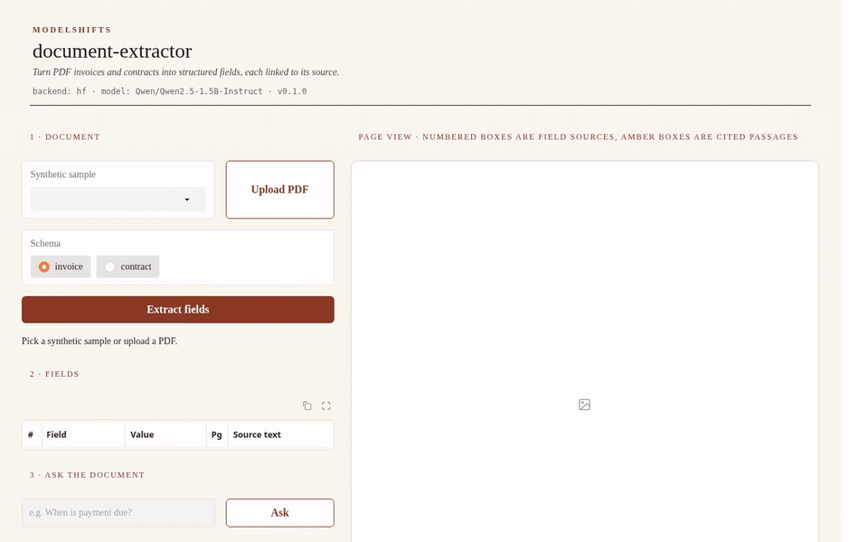
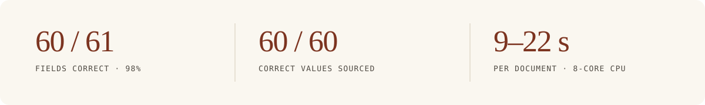
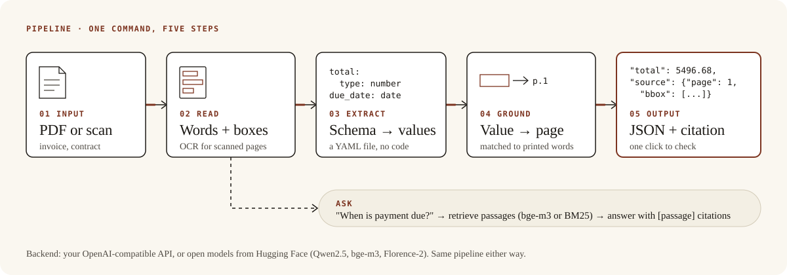
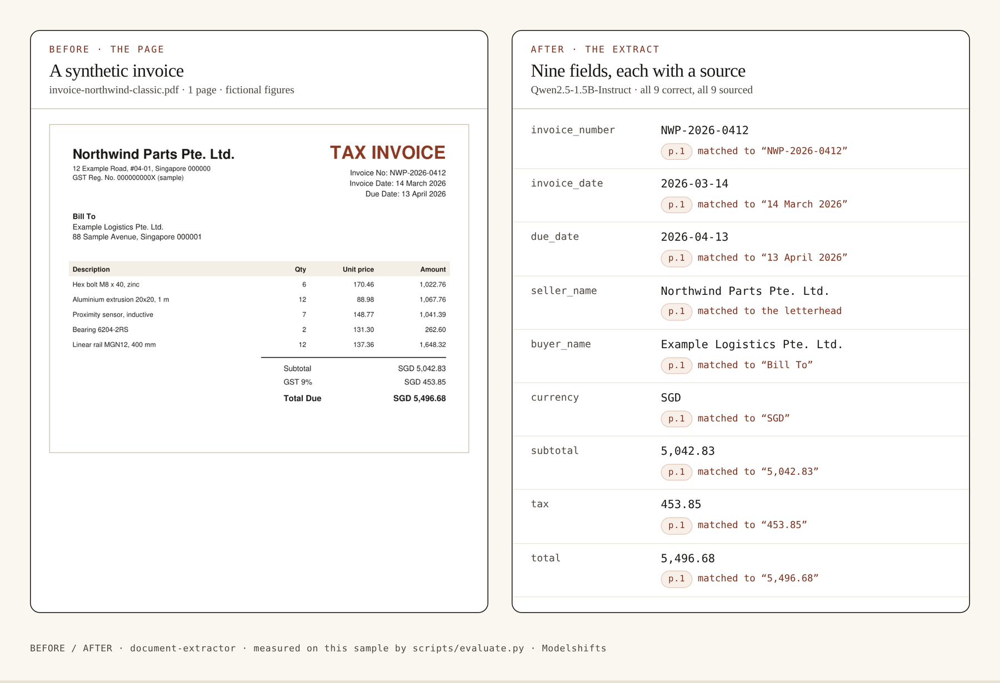

<p align="center">
  
</p>

<p align="center"><strong>A PDF goes in. Structured fields come out, each one pointing back to the words on the page.</strong></p>

<p align="center">
  <a href="https://github.com/ModelShifts/document-extractor/actions/workflows/ci.yml"></a>
  
  
  
  
</p>

<p align="center">
  
</p>
<p align="center"><sub>Web demo on an invoice (<a href="assets/demo.mp4">MP4</a>). The recording replays results computed by Qwen2.5-1.5B-Instruct.</sub></p>

<p align="center">
  
</p>

## The problem

Imagine a finance operations desk that closes the week by retyping 400 invoices. Each one is a PDF: a number, a due date, a total, two company names. Someone opens the file, finds those nine fields, and keys them into a spreadsheet. The work is careful and slow, and a transposed digit is easy to miss until a payment comes back.

The useful result is not a model that can “read PDFs.” It is a list of fields a person can audit, because every value still knows the place on the page it came from.

## How it works

The pipeline is five steps, and a sixth if you ask a question.

1. A PDF or a scan comes in.
2. The page is read into words with coordinates. Scanned pages go through Florence-2.
3. A YAML schema lists the fields you want — invoice number, totals, parties, dates. No extraction code to write.
4. Each returned value is matched back to the printed words on the page.
5. You get JSON, and every value carries its page, bounding box and source text.

Ask a question (“When is payment due?”) and a retriever — bge-m3, or BM25 — picks passages; the model answers with citations. Point it at a folder and it writes one CSV or JSON for the run.

<p align="center">
  
</p>
<p align="center"><sub>The same five steps, whether the backend is your API or open models on your own machine.</sub></p>

One of the samples, before and after:

<p align="center">
  
</p>
<p align="center"><sub><code>invoice-northwind-classic.pdf</code> beside the extract. All nine fields correct, all nine sourced. <a href="scripts/evaluate.py"><code>scripts/evaluate.py</code></a>.</sub></p>

Think of each field as a claim, and the bounding box as the exhibit attached to it.

## Results

On seven PDFs — four invoice layouts, two contracts, and one image-only scan — the Hugging Face backend with Qwen2.5-1.5B-Instruct got **60 of 61 fields correct (98%)**. Every correct value also carried a source box whose text matches the value (**60/60**).

The one miss is an OCR slip on the scanned invoice: `buyer_name` came back as `Northwind Parts Pte., Ltd.` (an extra comma) instead of `Northwind Parts Pte. Ltd.`

| Sample | Correct | Sourced | Time (s) | Notes |
|---|---|---|---|---|
| contract-master-services.pdf | 8/8 | 8/8 | 18.7 | — |
| contract-supply.pdf | 8/8 | 8/8 | 9.0 | — |
| invoice-acme-scanned.pdf | 8/9 | 8/8 | 22.1 | `buyer_name`: extra OCR comma |
| invoice-demo-freight-compact.pdf | 9/9 | 9/9 | 10.5 | — |
| invoice-example-logistics-banner.pdf | 9/9 | 9/9 | 9.7 | — |
| invoice-northwind-classic.pdf | 9/9 | 9/9 | 10.9 | — |
| invoice-placeholder-two-page.pdf | 9/9 | 9/9 | 13.6 | — |
| **All** | **60/61 (98%)** | **60/60** | **9.0–22.1** | |

**Methodology.** Seven PDFs (four invoice layouts, two contracts, one image-only scan), 61 fields in total. A field counts as correct when the typed value matches the ground truth in [`samples/*.truth.json`](samples/) (strings compared case-insensitively, extra spaces and trailing punctuation ignored; numbers within 0.005). “Sourced” counts correct values that also carry a source box whose text matches the value. [`python scripts/evaluate.py`](scripts/evaluate.py). Hugging Face backend, Qwen2.5-1.5B-Instruct, Florence-2 for the scanned page, 12 November 2026. Wall-clock for all seven samples was 96 seconds, including model load. Per-document times were 9.0–22.1 seconds. The raw table is in [`docs/eval.md`](docs/eval.md).

The API backend against a local llama.cpp server (Qwen2.5-1.5B-Instruct, Q4_K_M) got 52 of 61 fields correct: all 52 fields on the six text-layer PDFs, in 3.9–12.1 seconds each. The scanned invoice is scored 0/9 there, because that backend has no OCR unless a vision model is configured.

## Why it matters

A total without a source is a rumour. A total with a bounding box is a claim you can audit — from `5,496.68` back to the printed “SGD 5,496.68” on the page, and reject it if the box is wrong. That is the difference between an extract you retype to be safe, and an extract you can actually use.

It fits anywhere a team already files PDFs and maintains a spreadsheet: accounts payable, contract intake, a records desk. The schema is a YAML file, so the fields can change without changing the code. The backend can be a hosted API or open models on your own machine; the rest of the pipeline stays the same.

## Quickstart

Python 3.11 or newer.

```bash
git clone https://github.com/ModelShifts/document-extractor
cd document-extractor
python -m venv .venv && source .venv/bin/activate
pip install -e ".[hf,demo]"      # open models; use ".[api,demo]" for the API backend
cp .env.example .env              # choose a backend and models
```

On a CPU-only machine, install the CPU build of PyTorch first (`pip install torch --index-url https://download.pytorch.org/whl/cpu`) and set `MS_HF_MODEL=Qwen/Qwen2.5-1.5B-Instruct` in `.env`. Models download from Hugging Face on first use.

```bash
# fields as JSON, each with {page, bbox, text}
document-extractor extract samples/invoice-northwind-classic.pdf --schema schemas/invoice.yaml

# a question, answered with cited passages
document-extractor ask samples/contract-master-services.pdf "When does the notice period start?"

# a folder to one CSV (or .json)
document-extractor batch samples --glob "invoice-*.pdf" --schema invoice --out results.csv

# the web demo at http://127.0.0.1:7860 (python app.py does the same)
document-extractor serve
```

A schema is a YAML file that lists fields and their types (`string`, `date`, `number`, `integer`). See [`schemas/invoice.yaml`](schemas/invoice.yaml) and [`schemas/contract.yaml`](schemas/contract.yaml). Dates come back as `YYYY-MM-DD` and amounts as numbers.

`samples/` holds seven PDFs (four invoice layouts, two contracts, one image-only scan) with a ground-truth file for each. Tests use a mocked model and need no downloads: `pip install -e ".[dev]" && pytest`.

## Backends

<details>
<summary>Two interchangeable backends — API key or open models. The rest of the pipeline does not change.</summary>

Pick one with `MS_BACKEND` in `.env`.

| | (a) Bring your own API key | (b) Open-source on Hugging Face |
|---|---|---|
| **What** | Any OpenAI-compatible endpoint | Open models, run locally with `transformers` |
| **Set** | `MS_BACKEND=api`, `MS_API_BASE`, `MS_API_KEY`, `MS_MODEL` | `MS_BACKEND=hf`, optionally `MS_HF_MODEL` |
| **Scanned pages** | `MS_VISION_MODEL` (a vision model on the same endpoint) | Florence-2 |
| **Q&A retrieval** | `MS_EMBED_MODEL` if set, otherwise BM25 | bge-m3 |
| **Good for** | Fastest start, hosted models | Data stays on your machines, no per-call cost |

**Default open-source models**

| Model | Used for | License |
|---|---|---|
| [`Qwen/Qwen2.5-7B-Instruct`](https://huggingface.co/Qwen/Qwen2.5-7B-Instruct) | field extraction and answers | Apache-2.0 |
| [`BAAI/bge-m3`](https://huggingface.co/BAAI/bge-m3) | embeddings for retrieval | MIT |
| [`florence-community/Florence-2-large`](https://huggingface.co/florence-community/Florence-2-large) | OCR for scanned pages (`transformers`-native copy of [`microsoft/Florence-2-large`](https://huggingface.co/microsoft/Florence-2-large)) | MIT |

On a machine without a GPU, set `MS_HF_MODEL=Qwen/Qwen2.5-1.5B-Instruct`. The 7B model needs a GPU or a lot of memory. `MS_RETRIEVER=bm25` skips the bge-m3 download and uses keyword retrieval instead.

To try the API backend without a paid key, run an open model behind a local OpenAI-compatible server, for example [llama-cpp-python](https://github.com/abetlen/llama-cpp-python):

```bash
pip install "llama-cpp-python[server]" huggingface_hub \
  --extra-index-url https://abetlen.github.io/llama-cpp-python/whl/cpu   # prebuilt CPU wheels, no compiler needed
hf download Qwen/Qwen2.5-1.5B-Instruct-GGUF qwen2.5-1.5b-instruct-q4_k_m.gguf --local-dir models
python -m llama_cpp.server --model models/qwen2.5-1.5b-instruct-q4_k_m.gguf --n_ctx 8192 --port 8001
# then: MS_API_BASE=http://127.0.0.1:8001/v1  MS_API_KEY=local  MS_MODEL=qwen2.5-1.5b-instruct-q4_k_m
```

</details>

## Roadmap

- [ ] Reranking retrieved passages with `BAAI/bge-reranker-v2-m3`
- [ ] Scanned-page OCR tested with a real vision model on the API backend
- [ ] Hosted demo

## License

[MIT](LICENSE) © Modelshifts Technology Pte. Ltd.

<p align="center"><sub>Part of the <a href="https://modelshifts.com/work">Modelshifts</a> showcase. November 2026, v1.</sub></p>
